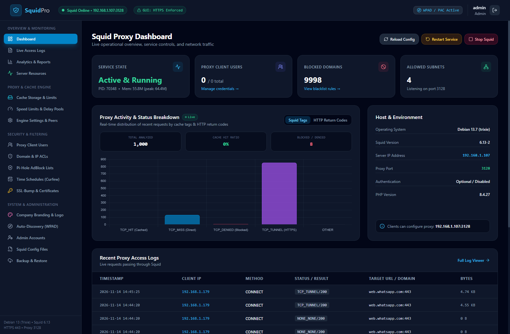

# Hi, I'm Andreas Emner 👋

### 🚀 Systems Architect & Infrastructure Engineer
#### Enterprise Linux (Red Hat) • VMware Virtualization • Advanced Networking • Cybersecurity & AI

```yaml
profile:
  identity: "Andreas Emner (@aemner)"
  background: "15+ years architecting, scaling, and securing enterprise infrastructure"
  domains:
    - "Red Hat Enterprise Linux (RHEL) & Deep Linux Systems Engineering"
    - "VMware vSphere / ESXi & Proxmox VE Hyper-Converged Virtualization"
    - "Advanced Enterprise Networking, Firewalls, Proxies & Zero Trust"
    - "Cybersecurity Governance, CISO/CSO Advisory & ISO 27001"
    - "AI-Driven Operations, Agentic Automation & Infrastructure as Code"
  philosophy: "Rock-solid reliability, security by design, automated at scale."
```

---

## 🏛️ Who I Am & What I've Done

I am a veteran **Systems Architect and Infrastructure Engineer** with over 15+ years of hands-on experience designing, operating, and securing tier-1 mission-critical enterprise environments. My career spans aerospace launch systems, global financial & healthcare institutions, and large-scale retail networks.

### What I've Built & Scaled:
* 🔴 **800+ Enterprise Linux Fleet**: Managed, safeguarded, and migrated fleets of over 800+ production Red Hat Enterprise Linux (RHEL) and Oracle Linux servers across multi-hypervisor setups and hybrid clouds (Azure, AWS, OCI).
* 🔷 **Enterprise VMware Clusters**: Architected and administered multi-datacenter VMware vSphere / ESXi environments, high-availability clusters (HA/DRS), HPE Synergy BladeSystems, 3PAR SAN storage fabrics, and automated Veeam disaster recovery.
* 🌐 **High-Capacity Enterprise Networking**: Engineered robust multi-site network fabrics, Next-Generation Firewalls, cross-country site-to-site IPsec & WireGuard VPNs, MPLS failovers, and enterprise-grade Squid Proxy infrastructures with SSL/TLS Peek-and-Splice inspection and automated WPAD discovery for 1,300+ concurrent enterprise users.
* 🛡️ **Cybersecurity Leadership (CISO / CSO)**: Directed end-to-end security programs, successfully obtaining full **ISO 27001 certification**, orchestrating enterprise SASE (Netskope) rollouts, and deploying defense-in-depth security with Palo Alto Cortex XDR and Trend Micro.
* 🤖 **AI & Modern Automation**: Leveraging modern agentic AI workflows, LLM-assisted systems diagnostics, Kubernetes (K8s), and declarative Infrastructure as Code (Terraform, Bicep, Ansible) to build self-healing, automated infrastructure.

---

## 🛠️ Deep Technical Pillars

<details open>
<summary><b>🔴 Red Hat & Enterprise Linux Mastery</b></summary>
<br>

* **Distributions & Kernels**: Red Hat Enterprise Linux (RHEL 7 / 8 / 9), Oracle Linux, Debian, Ubuntu Server.
* **Systems Hardening**: Deep SELinux policy configuration, PAM security, kernel parameter optimization, auditd, and CIS Benchmark compliance.
* **Fleet Management & Automation**: Ansible automation playbooks, Red Hat Satellite / Spacewalk, custom RPM packaging, systemd service management, and automated patch baselines.
* **High Availability**: Pacemaker, Corosync, Enterprise LVM, DRBD, and clustered storage systems.

</details>

<details open>
<summary><b>🔷 VMware, Virtualization & Cloud</b></summary>
<br>

* **VMware Stack**: VMware vSphere, vCenter 6.x / 7.x, ESXi host clustering, Distributed Switches (vDS), HA, DRS, and Storage vMotion.
* **Storage & Hardware Fabrics**: HPE Synergy BladeSystems, HPE 3PAR SANs, Fiber Channel, iSCSI, NFS, and multi-pathing configuration.
* **Proxmox VE & KVM**: Proxmox VE hyper-converged clusters, Ceph storage integration, REST API automation, Cloud-Init template pipelines, and KVM hypervisor migrations (successfully migrated 800 workloads with zero downtime).
* **Public & Hybrid Cloud**: Microsoft Azure (Landing Zones, Bicep), AWS, and Oracle Cloud Infrastructure (OCI).

</details>

<details open>
<summary><b>🌐 Advanced Enterprise Networking & Edge Gateways</b></summary>
<br>

* **Proxies & SSL Inspection**: Enterprise Squid Proxy (Peek-and-Splice SSL-Bump), dynamic certificate authority (CA) generation, URL filtering, and Pi-Hole DNS sinks.
* **Auto-Discovery & Traffic Routing**: WPAD / PAC automated proxy discovery, DHCP Option 252, reverse proxies (Nginx), and edge load balancers.
* **Routing & Multi-Site Connectivity**: Next-Gen Firewalls, Site-to-Site IPsec, WireGuard, OpenVPN, MPLS redundant backbones, VLAN micro-segmentation, and NAT/PAT topologies.
* **Zero Trust & SASE**: Netskope Secure Access Service Edge (SASE) rollout, cloud edge access policies, and identity-aware perimeter control.

</details>

<details open>
<summary><b>🛡️ Cybersecurity, Governance & AI Automation</b></summary>
<br>

* **Governance & Standards**: ISO 27001 lead auditor/implementer, CISO strategic roadmaps, disaster recovery (DR) protocols, and security audits.
* **Threat Detection & Response**: Palo Alto Cortex XDR, Trend Micro Deep Security, SIEM log intelligence, and automated threat containment.
* **AI & Agentic Workflows**: Integrating AI agents for DevOps automation, real-time log anomaly detection, and automated root cause analysis.
* **IaC & Containers**: Kubernetes (K8s), Docker, Terraform, Bicep, Ansible, Bash, and PowerShell scripting.

</details>

---

## 🧰 Tech Stack Badges

### Enterprise Linux & Virtualization


### Networking & Security


### Automation, IaC & AI


---

## 🌟 Featured Engineering Projects

### 🦑 [SquidPro](https://github.com/aemner/squidpro)
> **Turnkey Enterprise Squid Web Proxy & SSL-Bump Administration Suite**
> * Dynamic real-time traffic visualization and interactive chart drill-downs.
> * Peek-and-Splice HTTPS inspection with automated CA generation & signing.
> * Turnkey one-liner automated installer for clean Debian/Ubuntu servers.
> * WPAD auto-discovery, Pi-Hole adblock sink integration, and high-performance cache purging engine.

<p align="center">
  <a href="https://github.com/aemner/squidpro">
    
  </a>
</p>

### ☁️ Proxmox Cloud Automation Engine
> **Zero-Touch Virtual Machine Lifecycle Management**
> * Automated template cloning, Cloud-Init injection, and network configuration via Proxmox VE REST APIs.
> * Self-healing provisioning pipelines with PowerShell and secure API token authorization.

### 🛡️ Enterprise Infrastructure Hardening Playbooks
> **Declarative Fleet Configuration & Hardening**
> * Production Ansible playbooks for automated operating system hardening, CIS benchmark compliance, and multi-cloud landing zones.

---

## 📊 Activity & Stats

<div align="center">
  
  
</div>

---

<div align="center">
  <sub>Built with precision. Red Hat • VMware • Networking • Security • AI</sub>
</div>